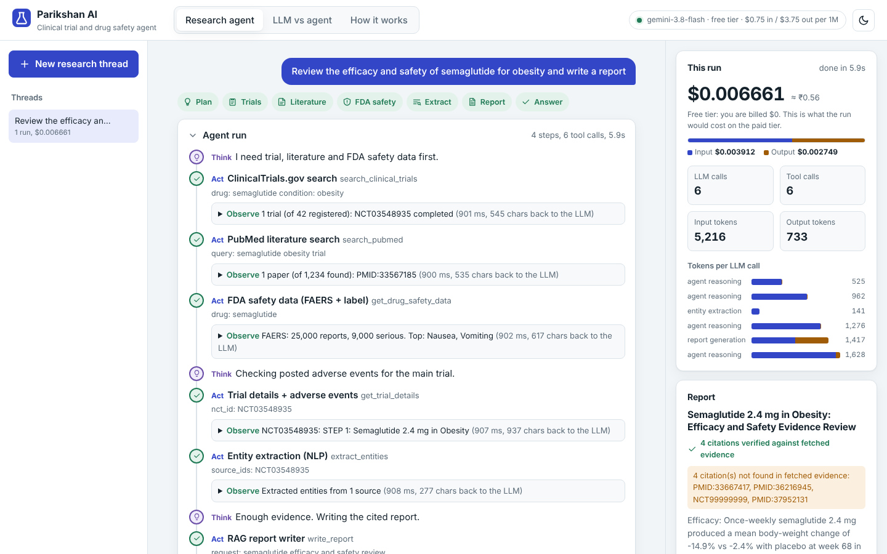
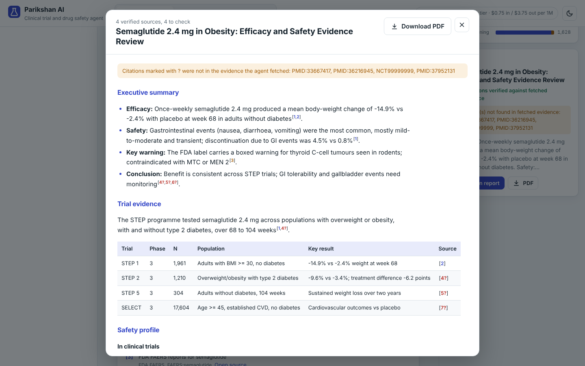
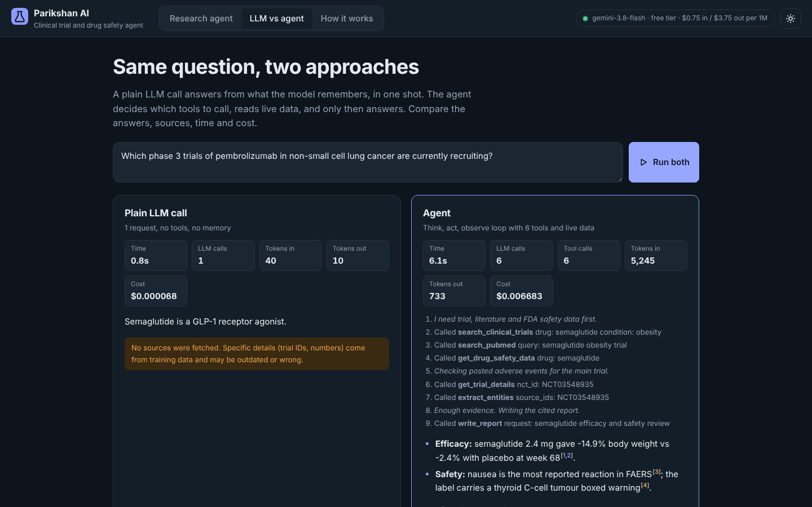
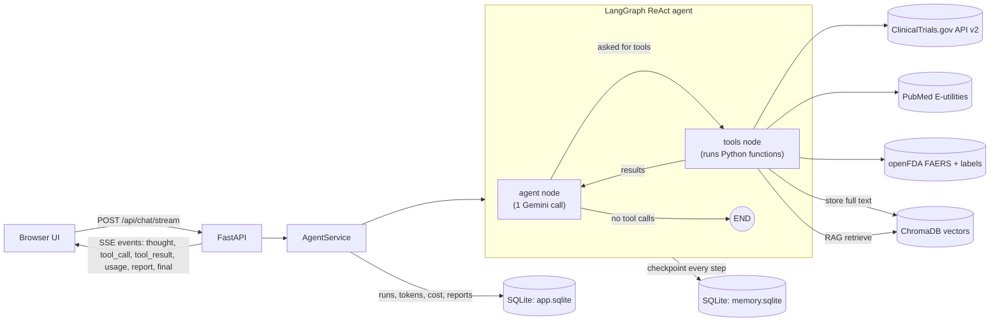
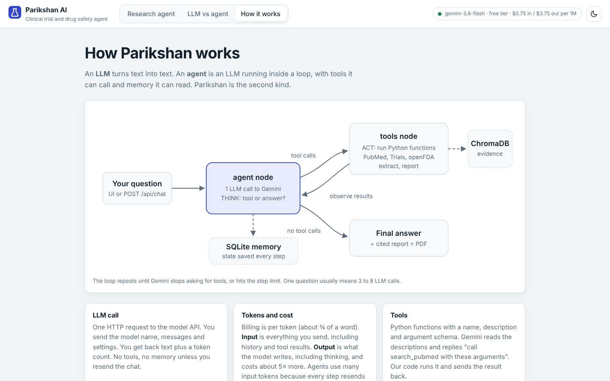

# Parikshan AI: Agentic Clinical Trial & Drug Safety Intelligence Platform

Parikshan (परीक्षण, "trial / test") is an AI agent for pharma research. You ask a question like
*"Compare the efficacy and GI safety of semaglutide vs tirzepatide"* and the agent decides on its own
which data sources to query (ClinicalTrials.gov, PubMed, FDA adverse event reports and drug labels),
reads the results, extracts drugs, doses, outcomes and safety signals, and writes a source-cited
pharmacovigilance report you can download as a PDF. Every reasoning step, tool call, token and rupee
is shown live in the UI.





> Screenshots were taken with the built-in offline demo (scripted LLM + sample API data), so the
> numbers in them are illustrative. Run it with your Gemini key for real results.

---

## Contents

1. [Concepts in simple words](#1-concepts-in-simple-words)
2. [LLM vs agent](#2-llm-vs-agent)
3. [Architecture and workflow](#3-architecture-and-workflow)
4. [Tech stack](#4-tech-stack)
5. [External APIs](#5-external-apis)
6. [The agent's tools](#6-the-agents-tools)
7. [Memory and storage: where is everything kept?](#7-memory-and-storage-where-is-everything-kept)
8. [Input and output cost](#8-input-and-output-cost)
9. [FastAPI backend and endpoints](#9-fastapi-backend-and-endpoints)
10. [The UI](#10-the-ui)
11. [Setup and run](#11-setup-and-run)
12. [Evaluation](#12-evaluation)
13. [Tests](#13-tests)
14. [Project structure](#14-project-structure)
15. [Interview cheat sheet](#15-interview-cheat-sheet)
16. [Limitations](#16-limitations)

---

## 1. Concepts in simple words

| Term | Simple meaning |
|---|---|
| **LLM** (Large Language Model) | A model like Gemini that reads text and writes text. It only *talks*: it cannot search a website, run code or remember you between calls on its own. |
| **LLM call** | One request to the model's API. You send the model name, the messages (system instruction, question, maybe chat history) and settings. You get back the answer plus a token count. |
| **Token** | The unit models read and bill in. Roughly ¾ of an English word. "pharmacovigilance" is several tokens. |
| **Input tokens** | Everything you *send*: system prompt + chat history + tool results + question. |
| **Output tokens** | Everything the model *writes*, including hidden "thinking" tokens on reasoning models. Output is priced higher. |
| **Agent** | An LLM inside a loop, with **tools** it may use and **memory** it can read. It decides by itself what to do next until the job is done. |
| **ReAct** | Reason + Act. The loop pattern: **Think** (what do I need?) → **Act** (call a tool) → **Observe** (read the result) → repeat → answer. |
| **Tool / function calling** | A tool is a normal Python function with a name, a description and typed arguments. Gemini sees the descriptions and replies "call `search_pubmed` with `query=...`". Our code runs it and sends back the result. The LLM never runs code itself. |
| **LangChain** | A Python library that gives one common interface for LLMs, tools, messages and prompts. |
| **LangGraph** | LangChain's agent runtime. The agent loop is written as a small graph (nodes + edges) with built-in memory, streaming and step limits. |
| **Memory (short-term)** | The conversation so far. Saved after every step so a follow-up like "now compare with liraglutide" works. |
| **Embedding** | A list of numbers that represents the *meaning* of a text. Similar meanings give similar numbers. |
| **Vector database** | A database that stores embeddings and finds the most similar ones fast. We use **ChromaDB**. |
| **RAG** (Retrieval-Augmented Generation) | Before writing, *retrieve* the most relevant chunks of real evidence from the vector DB and give only those to the LLM, which must cite them. Cuts hallucination. |
| **Hallucination** | The model stating something that is not in any source (for example a made-up trial ID). We detect cited IDs that were never fetched. |
| **FastAPI** | A Python web framework. It turns Python functions into web endpoints (URLs) and auto-generates API docs. |
| **SSE** (Server-Sent Events) | One long HTTP response through which the server pushes small messages. Used to stream each agent step to the browser live. |
| **Pydantic** | Data validation with Python type hints. Used for API requests, settings and the structured entity-extraction output. |
| **SQLite** | A full SQL database stored in a single file. No server to install. |
| **Pharmacovigilance** | Detecting, assessing and preventing adverse effects of medicines. |
| **FAERS** | FDA Adverse Event Reporting System: voluntary reports of side effects from patients, doctors and companies. |

## 2. LLM vs agent

| | Plain LLM call | Agent (Parikshan) |
|---|---|---|
| What it is | 1 request → 1 response | A loop of many LLM calls + tool runs |
| Data | Only what it learned in training (can be outdated) | Live data from ClinicalTrials.gov, PubMed, openFDA |
| Decides what to do | No, it just answers | Yes, picks tools, order and when to stop |
| Memory | None, unless you resend the chat | Conversation saved in SQLite per thread |
| Sources | None | Every claim cited, citations verified |
| LLM calls per question | 1 | Usually 3 to 8 |
| Cost and time | Low | Higher (history and tool results are re-sent each step) |

The UI has an **LLM vs agent** tab that runs the same question both ways side by side.



Two learning scripts show the difference in raw code, without any framework:

- `scripts/llm_call_demo.py`: one LLM call with the official `google-genai` SDK, printing input/output tokens and cost.
- `scripts/agent_from_scratch.py`: a 60-line agent loop written by hand with Gemini function calling. This is exactly what LangGraph automates.

## 3. Architecture and workflow



### What happens when you ask *"Review the efficacy and safety of semaglutide for obesity and write a report"*

1. **UI → FastAPI.** The browser sends the question (and thread id, if continuing a conversation) to `POST /api/chat/stream`.
2. **Load memory.** LangGraph loads this thread's previous messages from `data/memory.sqlite`.
3. **Think (LLM call #1).** The *agent node* sends Gemini: system prompt + history + question + the 6 tool descriptions. Gemini replies with a short reasoning sentence and tool calls, for example `search_clinical_trials(drug="semaglutide", condition="obesity")`, `search_pubmed(...)`, `get_drug_safety_data(drug="semaglutide")`.
4. **Act.** The *tools node* runs those Python functions (in parallel). Each one calls a free public API.
5. **Store evidence.** Each tool saves the *full* text of every paper / trial / FDA record into **ChromaDB** (chunked + embedded), tagged with its citation ID (`PMID:…`, `NCT…`, `FAERS:…`, `LABEL:…`).
6. **Observe.** Each tool returns a *short* JSON summary to Gemini (to keep input tokens low).
7. **Think again (LLM call #2, #3…).** Gemini reads the results and decides the next step: open a trial's details (eligibility + posted adverse events), run `extract_entities` (NLP extraction of drugs, doses, outcomes, AEs, using structured output), or finish.
8. **Report (RAG).** `write_report` retrieves the most relevant evidence chunks from ChromaDB, asks Gemini to write a Markdown report that cites every claim, then **verifies every citation** against the evidence actually fetched. Unknown IDs are flagged as possible hallucinations. The report is saved and exported to PDF.
9. **Answer.** Gemini replies without tool calls → the loop ends → final answer streams to the UI.
10. **Log.** Run status, tools used, every LLM call's tokens, latency and cost go to `data/app.sqlite`.

Each step is streamed to the browser as an SSE event, so you watch Think → Act → Observe happen live.

### The graph code (app/agent/graph.py)

```python
graph = StateGraph(MessagesState)
graph.add_node("agent", agent)                      # one Gemini call with tools bound
graph.add_node("tools", ToolNode(ALL_TOOLS))        # runs the requested tools
graph.add_edge(START, "agent")
graph.add_conditional_edges("agent", tools_condition, {"tools": "tools", END: END})
graph.add_edge("tools", "agent")                    # observe, then think again
app = graph.compile(checkpointer=AsyncSqliteSaver(...))  # memory
```

**Why LangGraph and not `AgentExecutor`?** `AgentExecutor` is LangChain's legacy agent class (it now lives in `langchain-classic`). LangGraph is the current, recommended runtime for agents: same ReAct idea, but the loop is explicit, and you get persistence (memory), streaming, step limits and human-in-the-loop hooks built in.

## 4. Tech stack

| Layer | Technology | Why |
|---|---|---|
| LLM | **Google Gemini 3.8 Flash** (`gemini-3.8-flash`) via Gemini Developer API | Free tier, fast, strong tool calling, 1M-token context. Changeable in `.env`. If it is overloaded (503) or rate-limited (429), the app switches automatically to the backup model `gemini-3.1-flash-lite` (`GEMINI_FALLBACK_MODEL`). |
| LLM SDK | `langchain-google-genai` (+ `google-genai` in the learning scripts) | Gemini as a LangChain chat model with tool calling and token usage |
| Agent framework | **LangGraph** (`StateGraph`, `ToolNode`, `tools_condition`) | Explicit ReAct loop, streaming, memory, recursion limit |
| Tools | LangChain `@tool` async functions | Docstring + type hints become the schema Gemini sees |
| Entity extraction | Gemini **structured output** into Pydantic models | Reliable JSON: drugs, dosages, outcomes, AEs, safety signals |
| Vector DB (RAG) | **ChromaDB** (persistent, on disk) | Simple, local, free. Cosine similarity search with metadata filters |
| Embeddings | `all-MiniLM-L6-v2` via ONNX (Chroma default), or Gemini `gemini-embedding-001` | Local = free and no rate limits |
| Short-term memory | LangGraph **AsyncSqliteSaver** checkpointer | Full agent state saved per thread after each step |
| App database | **SQLite** (`sqlite3`) | Runs, LLM calls, token usage, cost, reports |
| Backend | **FastAPI** + **Uvicorn** + **sse-starlette** | Async API, live streaming, auto docs at `/docs` |
| Validation / config | **Pydantic v2**, **pydantic-settings** | Typed request bodies and `.env` settings |
| HTTP client | **httpx** (async) with retry + backoff | Calls the external APIs |
| PDF export | **ReportLab** | Pure Python. One font family, real tables with wrapped cells, numbered references like a journal paper |
| Frontend | Plain **HTML + CSS + JavaScript**, `marked` + `DOMPurify` (vendored) | No build step; streams SSE with `fetch` |
| Testing | **pytest**, pytest-asyncio, **respx** (HTTP mocking), fake LLM | Whole agent loop tested offline |

## 5. External APIs

All three are free and need **no API key**.

| API | Endpoint(s) used | What we get | Limits |
|---|---|---|---|
| **NCBI E-utilities (PubMed)** | `esearch.fcgi` (find PMIDs), `efetch.fcgi` (abstracts as XML) | Titles, abstracts, journal, year, publication type | 3 req/s without key, 10 with a free `NCBI_API_KEY` |
| **ClinicalTrials.gov API v2** | `/api/v2/studies` (search), `/api/v2/studies/{NCT}` (one trial) | Status, phase, enrollment, sponsor, outcomes, eligibility, posted adverse events per arm | Fair use |
| **openFDA** | `/drug/event.json` (FAERS), `/drug/label.json` (labels) | Total / serious / death report counts, top reactions, boxed warning, warnings | 240 req/min, 1,000/day per IP without key |
| **Gemini API** | `generateContent` (through LangChain) | The LLM itself | Free-tier rate limits per minute/day (see AI Studio) |

## 6. The agent's tools

| Tool | What it does | Source |
|---|---|---|
| `search_clinical_trials` | Find trials for a drug (filters: condition, status, phase) | ClinicalTrials.gov |
| `get_trial_details` | Eligibility, outcomes and posted adverse events (% per arm) for one NCT ID | ClinicalTrials.gov |
| `search_pubmed` | Find papers, return abstracts | PubMed |
| `get_drug_safety_data` | FAERS report counts + top reactions + label boxed warning | openFDA |
| `extract_entities` | NLP extraction: drugs, dosages, population, outcomes, adverse events, safety signals (structured JSON) | Gemini over fetched sources |
| `write_report` | RAG report: retrieve → generate with citations → verify citations → save → PDF | ChromaDB + Gemini |

Tool results sent back to the LLM are capped at about 6,000 characters. Full texts go to ChromaDB instead. This keeps input tokens (and cost) under control.

## 7. Memory and storage: where is everything kept?

Everything lives in the `data/` folder (git-ignored):

| What | Where | Technology | Notes |
|---|---|---|---|
| **Conversation memory** (short-term) | `data/memory.sqlite` | LangGraph `AsyncSqliteSaver` | Every message, tool call and tool result, saved after every step, keyed by `thread_id`. Last `HISTORY_MESSAGES_KEPT` messages are sent to the LLM. |
| **Evidence knowledge base** (long-term, RAG) | `data/chroma/` | ChromaDB | Chunks of every fetched paper / trial / FDA record + embeddings + metadata (`thread_id`, `source_id`, `url`) |
| **Run logs, token usage, cost** | `data/app.sqlite` → `runs`, `llm_calls` | SQLite | Used by the UI history, stats and evaluation |
| **Reports** | `data/app.sqlite` → `reports`, PDFs in `data/reports/` | SQLite + files | Markdown, verified/unverified citations, PDF path |

Deleting a thread in the UI removes it from all three stores.

## 8. Input and output cost

**Formula** (same for every LLM provider):

```
cost = input_tokens / 1,000,000 × input_price  +  output_tokens / 1,000,000 × output_price
```

**Gemini prices** (Gemini Developer API, Standard tier, USD per 1M text tokens, from
[ai.google.dev/gemini-api/docs/pricing](https://ai.google.dev/gemini-api/docs/pricing), checked 16 Oct 2026):

| Model | Free tier | Input | Output (incl. thinking) |
|---|---|---|---|
| **gemini-3.8-flash** (default) | Yes | $0.75 (until 31 Dec 2026, then $1.50) | $3.75 (then $7.50) |
| gemini-3.1-flash-lite | Yes | $0.25 | $1.50 |
| gemini-2.5-flash | No longer offered to new users | $0.30 | $2.50 |
| gemini-2.5-pro | Yes | $1.25 | $10.00 |

Free tier: you pay **$0**, rate limits are lower, and Google may use the data to improve its products. Paid tier: data is not used for training. Prices change, so edit `app/cost.py` or set `PRICE_INPUT_PER_M` / `PRICE_OUTPUT_PER_M` in `.env`.

**Worked example** (a typical full report run on 3.8 Flash):
6 LLM calls, 25,000 input tokens, 2,500 output tokens
→ 25,000/1M × $0.75 + 2,500/1M × $3.75 = $0.01875 + $0.009375 = **≈ $0.028 (≈ ₹2.4)**.

**Why agents cost more than one LLM call:** every loop step re-sends the system prompt, the tool descriptions, the whole conversation and all previous tool results. Input tokens grow with each step.

**How the app tracks it:** a LangChain callback (`UsageTracker` in `app/cost.py`) fires on *every* LLM call, including calls made inside tools (entity extraction, report writing), reads `usage_metadata` (input, output, thinking tokens), prices it, and streams running totals to the UI. Every call is stored in the `llm_calls` table with its purpose: `agent_reasoning`, `entity_extraction`, `report_generation`, `plain_llm_call`.

**Cost controls built in:** short tool summaries to the LLM (full text to ChromaDB), history window (`HISTORY_MESSAGES_KEPT`), step limit (`MAX_AGENT_STEPS`), optional `THINKING_BUDGET`, cheap default model.

## 9. FastAPI backend and endpoints

FastAPI turns Python functions into HTTP endpoints, validates inputs with Pydantic, and serves interactive docs at **http://localhost:8000/docs**, where you can try every endpoint.

| Method | Path | Purpose |
|---|---|---|
| GET | `/api/health` | Model, tier, prices, tool list, API-key status |
| POST | `/api/chat/stream` | Run the agent and **stream** steps as SSE (`thought`, `tool_call`, `tool_result`, `usage`, `report`, `final`, `run_finished`) |
| POST | `/api/chat` | Run the agent and return one JSON (for Postman, scripts, evaluation) |
| POST | `/api/compare` | One plain LLM call (no tools), for the LLM vs agent comparison |
| GET | `/api/threads` | List conversations |
| GET | `/api/threads/{id}` | A thread's messages (from memory) and runs |
| DELETE | `/api/threads/{id}` | Forget a thread (memory, vectors, logs) |
| GET | `/api/runs` | Run history with tokens and cost |
| GET | `/api/stats` | Totals: runs, tokens, cost, completion rate, cost by purpose |
| GET | `/api/reports/{id}` | Report Markdown + citations |
| GET | `/api/reports/{id}/pdf` | Download the PDF |
| GET | `/` | The web UI |

Example:

```bash
curl -X POST http://localhost:8000/api/chat \
  -H "Content-Type: application/json" \
  -d '{"message": "What are the most reported adverse events for isotretinoin?"}'
```

Send the returned `thread_id` with the next message to continue the same conversation (memory).

## 10. The UI

Three tabs, served by FastAPI at `http://localhost:8000`:

- **Research agent**: ask a question and watch it work.
  - A **stage tracker** (Plan, Trials, Literature, FDA safety, Extract, Report, Answer) lights up as the agent moves.
  - The live **trace** shows each *Think* step (purple), *Act* step with the tool and its arguments (blue), and *Observe* step with what came back (green).
  - The **answer** has numbered citations [1] that link to a sources list.
  - The right panel shows the **cost** (USD and INR, split into input and output), LLM and tool call counts, and a **token bar per LLM call**.
  - The **report** card opens a full reader with numbered references and a PDF download. Citations not found in fetched evidence are marked with a red "?".
  - Threads on the left keep memory for follow-ups.
- **LLM vs agent**: the same question through one plain LLM call and through the agent, with time, calls, tokens and cost side by side.
- **How it works**: the loop diagram and plain-language explanations.

Has a **light/dark toggle** (top right, remembered per browser; follows your system setting by default) and works on mobile.



## 11. Setup and run

Requires **Python 3.11+** (tested on 3.13). Works on a MacBook Air M1, no GPU needed.

```bash
git clone https://github.com/7Pushkar7/Parikshan-AI.git
cd Parikshan-AI
python3 -m venv .venv && source .venv/bin/activate
pip install -r requirements.txt

cp .env.example .env
# open .env and paste your free key from https://aistudio.google.com/apikey into GEMINI_API_KEY

python scripts/check_setup.py   # 1 real Gemini call + 1 request to each medical API
uvicorn app.main:app --reload
```

Open **http://localhost:8000** (UI) or **http://localhost:8000/docs** (API docs).

Presenting it? Follow the step-by-step [demo guide](docs/DEMO_GUIDE.md).

**Updating to the latest version** (stop the app with `Ctrl + C` first):

```bash
git pull
pip install -r requirements.txt   # picks up any new libraries
uvicorn app.main:app --reload
```

Then hard-refresh the browser (`Cmd + Shift + R`) so it loads the new UI.

- First report run downloads the small local embedding model (~80 MB) once.
- If Google returns 503 (model busy) or 429 (free-tier limit), the app retries and then switches to `GEMINI_FALLBACK_MODEL` on its own. The cost panel prices each call by the model that actually answered.
- Learning scripts: `python scripts/llm_call_demo.py` and `python scripts/agent_from_scratch.py`.
- No key yet? `pip install -r requirements-dev.txt && python -m tests.offline_server` starts the UI with a scripted fake LLM and sample data, to click through the interface. Not real results.

## 12. Evaluation

`eval/queries.json` has **16 drug queries** (semaglutide, tirzepatide, pembrolizumab, isotretinoin, warfarin, clozapine, amiodarone, metformin, atorvastatin, adalimumab, lisinopril, empagliflozin, dupilumab, ciprofloxacin, sertraline, montelukast). Each has the tools a correct run must use and well-established facts (from FDA labels / pivotal trials) a correct answer must mention.

```bash
python -m eval.run_eval --delay 20        # all 16, pausing 20s between queries for free-tier limits
python -m eval.run_eval --only q01,q04    # specific queries
```

| Metric | Definition |
|---|---|
| Task completion rate | Run ended normally with an answer (and a report when asked), within the step limit |
| Tool recall | Share of the expected tools the agent actually called |
| Tool-call success | Share of tool calls that returned data instead of an error |
| Citation grounding | Share of cited IDs (answer + report) that exist in evidence the agent really fetched. Below 1.0 means hallucinated citations |
| Fact coverage | Share of expected facts found in the answer + report |
| Cost / latency | Average LLM calls, tokens, USD and seconds per query |

Results are saved to `eval/results/eval_<timestamp>.json` with a Markdown table printed in the terminal.

**My results:** _run the evaluation and paste the summary table here._

| Metric | Result |
|---|---|
| Task completion rate | |
| Tool recall | |
| Tool-call success | |
| Citation grounding | |
| Fact coverage | |
| Avg cost per query (USD) | |
| Avg latency (s) | |

> Before quoting fact coverage, check the expected facts in `eval/queries.json` against the FDA labels / papers yourself and add more. That makes it truly "manually verified".

## 13. Tests

```bash
pip install -r requirements-dev.txt
pytest -q
```

The tests run **fully offline**: external APIs are mocked with `respx` using payloads shaped like the real ones, and Gemini is replaced by a scripted fake model that makes real tool calls. They cover API parsing, cost math, citation verification (a fake trial ID must be flagged), history trimming, the complete agent loop (6 tool calls, report, PDF, memory across turns, forgetting a thread), every FastAPI endpoint including SSE streaming, and the evaluation harness.

## 14. Project structure

```
Parikshan-AI/
├── app/
│   ├── main.py                 # FastAPI app: endpoints, SSE streaming, serves the UI
│   ├── config.py               # settings from .env (pydantic-settings)
│   ├── llm.py                  # Gemini chat model + one plain LLM call
│   ├── cost.py                 # price table + UsageTracker callback (tokens, cost per call)
│   ├── pdf.py                  # Markdown report -> PDF
│   ├── agent/
│   │   ├── graph.py            # LangGraph ReAct loop (agent node <-> tools node) + history window
│   │   ├── prompts.py          # system prompt: role, tool strategy, citation rules
│   │   └── service.py          # runs the graph, turns updates into UI events, logs runs
│   ├── tools/
│   │   ├── research.py         # search_clinical_trials, get_trial_details, search_pubmed, get_drug_safety_data
│   │   └── analysis.py         # extract_entities (structured output), write_report (RAG + citation check)
│   ├── clients/                # raw API clients: pubmed.py, clinical_trials.py, openfda.py, http.py (retry)
│   ├── rag/vector_store.py     # ChromaDB: chunk, embed, store, search
│   └── storage/db.py           # SQLite: runs, llm_calls, reports
├── static/                     # UI: index.html, styles.css, app.js, vendor/ (marked, DOMPurify)
├── eval/                       # queries.json (16 drug queries) + run_eval.py
├── scripts/                    # llm_call_demo.py, agent_from_scratch.py (learning)
├── tests/                      # offline tests, fake Gemini, offline demo server
├── docs/screenshots/
├── requirements.txt / requirements-dev.txt
└── .env.example
```

## 15. Interview cheat sheet

- **What is an agent?** An LLM in a loop with tools and memory that decides its own next step. Mine uses the ReAct pattern on LangGraph.
- **How does the LLM "call" a tool?** It doesn't run anything. It returns a structured request (tool name + JSON args) based on the tool schemas we send. My code executes it and sends the result back as a ToolMessage.
- **How do you stop infinite loops?** `recursion_limit` (2 × `MAX_AGENT_STEPS` + 1 graph steps), a clear prompt on when to stop, and errors returned to the model as messages instead of crashing.
- **How do you reduce hallucination?** Live data instead of model memory, RAG over fetched evidence only, mandatory citations, and an automatic check that flags any cited ID never fetched.
- **How is memory implemented?** LangGraph checkpointer writes the state to SQLite after every step, keyed by `thread_id`. A history window limits what is re-sent. Evidence is long-term in ChromaDB.
- **How do you control cost?** Token tracking per call, short tool summaries, history window, step limit, thinking budget, cheapest capable model. Output tokens cost about 5× input on 3.8 Flash, so the agent writes short answers and only one long report.
- **Why FastAPI?** Async (many slow API calls), Pydantic validation, SSE streaming, auto docs.
- **Why SSE and not WebSockets?** Data flows one way (server → browser) per request. SSE is plain HTTP and simpler.
- **What would you add for production?** Auth, rate limiting, Postgres + pgvector instead of SQLite/Chroma, a job queue for long runs, LangSmith/OpenTelemetry tracing, caching API responses, human review before reports are shared.

## 16. Limitations

- For research and education only. Not medical advice, and not a validated pharmacovigilance system.
- FAERS counts are voluntary, unverified reports. They show reporting volume, not incidence or causation.
- Only trials whose sponsors posted results have adverse event tables on ClinicalTrials.gov.
- PubMed abstracts only (no full text).
- Free-tier Gemini has rate limits and Google may use free-tier data to improve its products: do not send confidential data.

---

Built by **Pushkar**, PGP student in AI & Data Science, Jio Institute.
